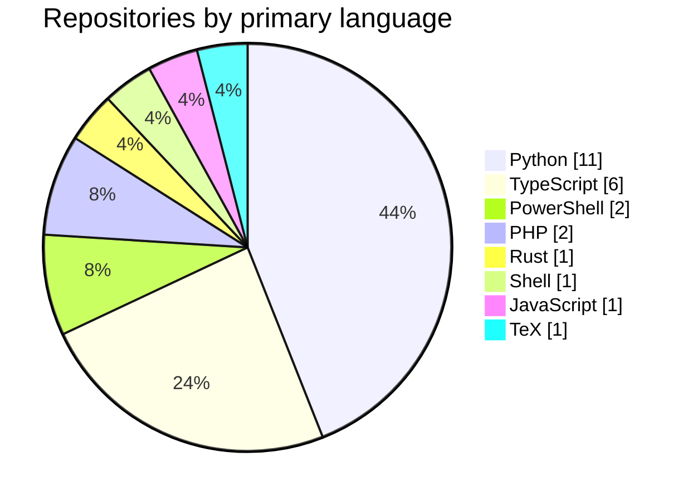
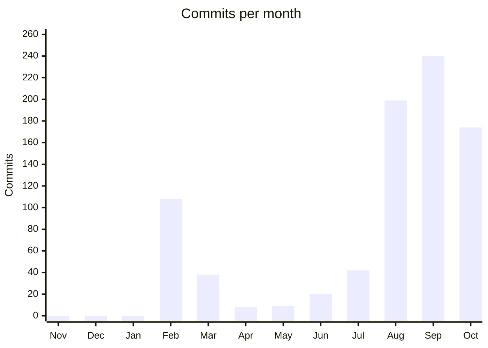

### Finance meets code

I build small, honest tools for money, data and security — portfolio backtests, public-registry data pipelines, Power Platform apps and website audits. Measured, tested, no hype.

